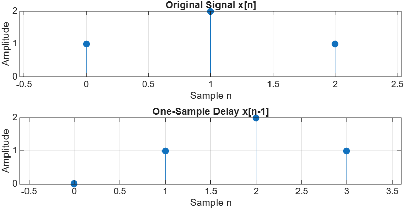
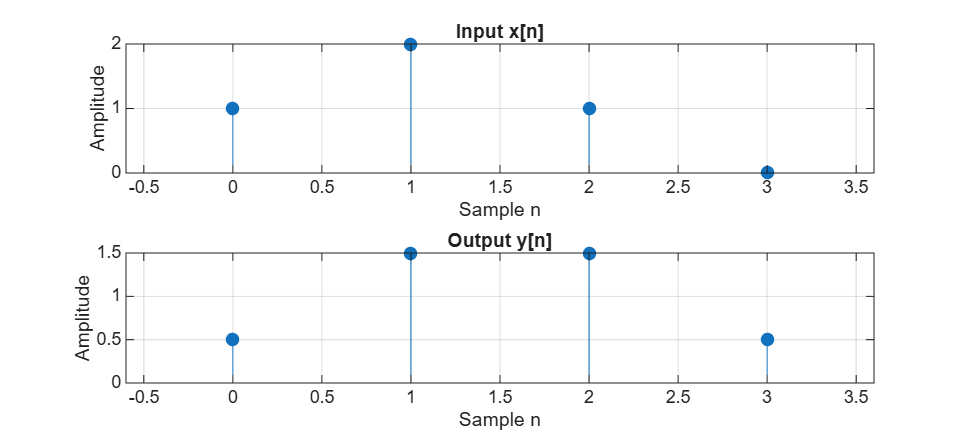
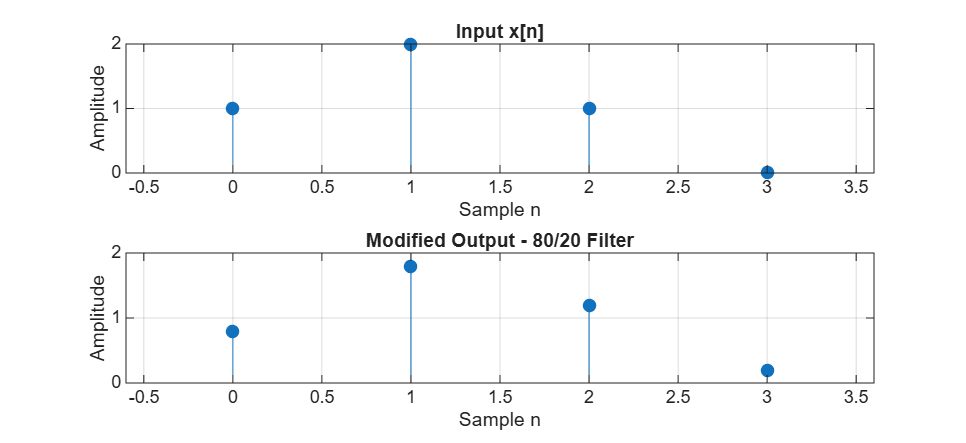

# Discrete-Time Signals and Z-Transform in MATLAB

## 1. Introduction

This assignment explores discrete-time signals, the Z-transform, and one-sample delays using MATLAB. The objective is to understand how signal samples are represented in the Z-domain and how a digital filter uses current and previous input samples to produce an output.

The assignment consists of two parts:

- **Part 1:** Representing a discrete-time signal and applying a one-sample delay.
- **Part 2:** Implementing a simple digital filter and comparing the outputs using different coefficients.

## 2. Part 1: Discrete-Time Signal and Z-Transform

The original signal contains three samples:

\[
x[n] = [1, 2, 1]
\]

Its Z-transform is:

\[
X(z) = 1 + 2z^{-1} + z^{-2}
\]

Using MATLAB, the original signal was plotted and delayed by one sample.

### MATLAB Results

**Figure 1: Original and One-Sample Delayed Signals**



The original signal contains the values `[1, 2, 1]` at sample indices 0, 1, and 2.

After applying a one-sample delay, the signal becomes `[0, 1, 2, 1]`. Each original sample moves one position to the right.

### Question 1: Identify the sample represented by each term in X(z).

Each term in the Z-transform represents a sample at a specific index.

| Term | Sample | Value |
|---|---|---|
| 1 | x[0] | 1 |
| 2z⁻¹ | x[1] | 2 |
| z⁻² | x[2] | 1 |

The exponent of z indicates the sample position, while its coefficient represents the sample amplitude.

### Question 2: Write the Z-transform of the delayed signal.

The original Z-transform is:

\[
X(z)=1+2z^{-1}+z^{-2}
\]

A one-sample delay shifts the original samples one position forward:

\[
x[n-1]=[0,1,2,1]
\]

Therefore, the delayed Z-transform becomes:

\[
X_{\text{delayed}}(z)=z^{-1}+2z^{-2}+z^{-3}
\]

### Question 3: Explain why delaying the signal by one sample multiplies X(z) by z⁻¹.

In the Z-domain, multiplying a signal by z⁻¹ represents a one-sample delay.

\[
z^{-1}X(z)=z^{-1}+2z^{-2}+z^{-3}
\]

This shifts each sample one position to the right in the time domain. Instead of changing every sample index manually, the Z-transform allows us to represent the delay through multiplication by z⁻¹.

## 3. Part 2: Digital Filter with One-Sample Delay

The second part uses a simple moving-average filter. The output is calculated using the current input and the previous input.

The system is defined as:

\[
y[n]=0.5x[n]+0.5x[n-1]
\]

Its transfer function is:

\[
H(z)=0.5+0.5z^{-1}
\]

Both input samples have equal influence on the output.

### MATLAB Results

**Figure 2: Input and Output Signals (50/50 Filter)**



MATLAB produced the following output:

```text
Output samples:
    0.5000    1.5000    1.5000    0.5000
```

### Question 4: Calculate y[0], y[1], y[2], and y[3] by hand. Compare them with MATLAB.

Using the equation:

\[
y[n]=0.5x[n]+0.5x[n-1]
\]

The calculations are:

**For n = 0:**

\[
y[0]=0.5(1)+0.5(0)=0.5
\]

**For n = 1:**

\[
y[1]=0.5(2)+0.5(1)=1.5
\]

**For n = 2:**

\[
y[2]=0.5(1)+0.5(2)=1.5
\]

**For n = 3:**

\[
y[3]=0.5(0)+0.5(1)=0.5
\]

| Sample | Manual Calculation | MATLAB Output |
|---|---|---|
| y[0] | 0.5 | 0.5 |
| y[1] | 1.5 | 1.5 |
| y[2] | 1.5 | 1.5 |
| y[3] | 0.5 | 0.5 |

The manual calculations match the expected MATLAB results.

### Question 5: Explain how b = [0.5 0.5] represents the two terms in H(z).

In MATLAB, the filter coefficients are defined as:

```matlab
b = [0.5 0.5];
a = 1;
```

The first value, `0.5`, represents the coefficient of the current input x[n].

The second value, `0.5`, represents the coefficient of the previous input x[n−1].

These coefficients correspond to the transfer function:

\[
H(z)=0.5+0.5z^{-1}
\]

The variable `a = 1` indicates that there are no feedback terms in this filter.

### Question 6: Change the system to H(z) = 0.8 + 0.2z⁻¹. Explain which input sample has more influence.

The filter coefficients were changed to:

```matlab
b = [0.8 0.2];
```

The new system becomes:

\[
y[n]=0.8x[n]+0.2x[n-1]
\]

**Figure 3: Input and Output Signals (80/20 Filter)**



The modified output is:

```text
Modified output samples:
    0.8000    1.8000    1.2000    0.2000
```

Comparing both filters:

| Sample | Original Filter (50/50) | Modified Filter (80/20) |
|---|---|---|
| y[0] | 0.5 | 0.8 |
| y[1] | 1.5 | 1.8 |
| y[2] | 1.5 | 1.2 |
| y[3] | 0.5 | 0.2 |

In the modified filter, the current input has more influence because its coefficient is 0.8, while the previous input has a coefficient of only 0.2.

As a result, the output follows the current input more closely compared to the original 50/50 filter.

## 4. Conclusion

This assignment helped me understand how discrete-time signals are represented using the Z-transform and how a one-sample delay affects the signal.

In Part 1, I observed that delaying a signal shifts its samples by one position and corresponds to multiplication by z⁻¹ in the Z-domain.

In Part 2, I implemented a simple digital filter using MATLAB's `filter()` function. By changing the filter coefficients, I observed how the current and previous input samples influence the output.

The results demonstrate how the Z-transform can be used to describe and analyze discrete-time systems.

## 5. Tools Used

- MATLAB
- Discrete-time signal plotting using `stem()`
- Digital filtering using `filter()`
- GitHub for assignment submission
